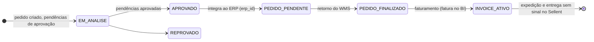

# Contexto de negócio — EGAPLAST

Registro vigente para o agente. Quando este arquivo divergir de `docs/produto-egaplast.md` ou do código, a divergência fica explícita. Não escolha um lado em silêncio.

Legenda: **fato** foi visto no repositório ou declarado pelo responsável nesta configuração; **hipótese** ainda depende de validação; **desconhecido** não está no código nem foi afirmado.

## Problema prioritário

**Fato declarado pelo responsável em 16/10/2026.** O problema prioritário é a rastreabilidade de pedidos entre Sellent, ERP SIFN e Monday.

O objetivo é identificar, para um pedido:

- a etapa operacional real;
- os SKUs envolvidos;
- as pendências;
- a área responsável;
- o motivo de o pedido estar parado.

**Regra de evidência.** O dado de um sistema não prova o estado de outro. Um status no Sellent, no SIFN ou no Monday descreve aquele sistema na data da consulta. A etapa operacional real só pode ser afirmada quando as fontes necessárias concordam, ou quando a divergência é mostrada como divergência.

## Sistemas

| Sistema | Papel conhecido | Acesso | No repositório |
|---|---|---|---|
| Sellent | Pedidos e condição comercial | Leitura (`GET`) confirmada em 16/10/2026 com o token da EGAPLAST. Ambiente de produção | Coleta em `scripts/coletar.ts` e `src/lib/sellent`. O token fica em `.env.local` (fora do git). Achados em "Achados verificados no Sellent" |
| ERP SIFN | ERP nomeado pelo responsável | Acesso ainda precisa ser obtido | Nenhuma referência |
| Monday | Fonte a cruzar na rastreabilidade | Não informado | Nenhuma referência |
| WMS Zion | Integração futura | Não obtido | Nenhuma referência |
| Frente de loja | Integração futura | Não obtido | Nenhuma referência |
| Frota | Frete de referência por UF, na mesa de demonstração | Não informado | A demo que exportava frete fictício foi retirada em 17/10/2026 |

Não há, neste repositório, prova de chaves de correlação entre esses sistemas. Número de pedido, SKU e cliente podem não usar o mesmo identificador. Isso é **desconhecido** até existir contrato ou amostra real.

## Decisão de produto — EGAPLAST Service (17/10/2026)

**Fato declarado pelo responsável.** O produto deste repositório passa a ser o EGAPLAST Service. A demo da mesa, da loja e do gestor saiu do código. O Service replica o Sellent em entidades próprias e, no trecho que hoje é o Monday, registra a etapa interna por SKU. Sellent e SIFN continuam donos do comercial e do fiscal. Nesta entrega não há leitura nem escrita no ERP.

**Fato.** O pacote npm é `egaplast-service`. A organização Supabase `egaplast` está no limite de projetos gratuitos, então não foi criado um segundo projeto com o nome `egaplast-service`. A base usada é o projeto vazio `egaplast` (`hdfiitvuzroelorwmguk`, região us-east-1), já referenciado em `.env.local`. O projeto antigo com o catálogo comercial (`zbllcsvystsakiwrqsgf`) não aparece mais na conta.

**Fato declarado pelo responsável.** A base guarda os dados necessários à operação e à análise, inclusive identificação de cliente, contato e vendedor. O acesso é por convite, com papel `admin` ou `operador`.

**Fato.** A réplica usa os nomes da API em inglês: `orders`, `order_items`, `customers` (a loja do Sellent), `sellers`, `order_statuses`, `pendencies`, `invoices` e `invoice_items`. O progresso interno é `stages` e `order_item_progress`, um por SKU. Quem faz login fica em `users`. O usuário do pedido no Sellent fica em `sellent_users`.

**Fato.** A coleta tem quatro fontes, nesta ordem: `orders_full`, `pendency_list`, `invoices`, `bi_orders`. Cada uma grava numa staging e só então promove, numa transação. Se a promoção falha, as tabelas finais daquela fonte ficam como estavam e as fontes seguintes não rodam. Pendência cujo pedido ainda não está em `orders` não é gravada. A fatura liga pelo número do ERP: o prefixo da `key` (`203430` em `203430_27802`) procura um único `orders.erp_number`. O `order_id` que a fatura traz não é o `id` do `orders_full`. O que não achar pedido entra na contagem de pulados, sem `order_id` nulo e sem pedido fabricado. `GET /orders` informa `pagination.total`. Em 17/10/2026 esse total era 1.787, igual ao `orders_full` gravado. A carga inicial só fecha se a leitura tiver esse tamanho. No mesmo dia, 1.215 pedidos estavam `INVOICE-ATIVO` e 1.189 tinham nota no BI; os outros 26 não aparecem em nenhuma das 10.471 faturas. O painel `/coleta` atualiza sozinho enquanto uma fonte está baixando, gravando ou fechando a transação, e depois mostra a última execução, o erro, os pulados e o atraso. `bi_orders` não vira tabela; atualiza previsão e rastreio do pedido cujo número de ERP coincide com o código. A promoção roda numa função SQL; o limite padrão de 8 segundos da API foi elevado para 10 minutos nos papéis `authenticator` e `authenticated`, porque a carga inteira de uma fonte não cabe nesse limite.

## O que o repositório já mostra

**Fato.** O aplicativo é o EGAPLAST Service (Next.js). A tela lê o Postgres. A coleta do Sellent é `npm run coletar`, somente `GET`. A demo em `localStorage` não faz mais parte das rotas.

## Navegação em Pedidos

**Fato (18/10/2026).** A lista em `/pedidos` usa **vista híbrida**: por padrão (`vista=operacional`, omitido na URL) mostra os **50 pedidos mais recentes** na réplica, ordenados por `updated_at` desc, mais uma faixa **Prioridades** (pendência, faturado sem nota, recusa ERP, em análise Sellent). `?vista=completa` expande a lista filtrada; filtros de negócio e KPIs financeiros aparecem nesse modo ou quando há filtro ativo. Filtros avançados (vendedor, UF, datas, toggles, atalhos de status) ficam em **Mais filtros**, fechados por padrão. Parâmetro `erp=` na URL persiste recorte ERP (`numero`, `recusa`, `sem`).

**Fato.** Clique na linha abre o **painel rápido** (`sel=`); **Abrir**, duplo-clique ou Ctrl+Enter vão à página completa com `from=`. Anterior/próximo na página completa usam o recorte gravado na sessão. A coluna **Prioridade** na tabela indica por que o pedido entra na fila de trabalho. O stepper de rastreio no painel cruza Sellent, nota no BI e progresso interno — **não prova** etapa no ERP SIFN. Setas movem a linha; Esc fecha o painel. Busca global (Ctrl+K) **mescla** texto no filtro atual e passa para vista completa.

**Fato (18/10/2026).** Recortes explícitos para o dia a dia:

| Rótulo na UI | Significado | Onde abrir |
|---|---|---|
| **Pedidos de hoje (Sellent)** | `order_date` no fuso São Paulo (data comercial do pedido) | `/acompanhamento` → Entrada do dia; menu **Precisa de ajuda?**; `/pedidos?de=…&ate=…&vista=completa` (consulta SQL no intervalo, não só os 5.000 mais recentes por `updated_at`) |
| **Desde a última coleta de pedidos** | Pedidos com ao menos um registro em `order_events` desde o `started_at` da última execução **succeeded** de `orders_full` | Mesmos atalhos; URL `recorte=movimento` |
| **Ver pedidos desta extração** | Janela `[started_at, finished_at]` de uma execução em `/coleta/[id]` | Admin na coleta; operador via lista de movimento equivalente |

**Glossário.** **Gravados** / **pedidos lidos** na tela Coleta são contagens da execução (API + promoção SQL), não uma lista pronta — a lista operacional correspondente é **movimento na réplica**. **Última atualização** na mesa de Pedidos (padrão) ordena por `updated_at` do Sellent na réplica; isso difere da **data do pedido**. O sino de notificações continua omitindo eventos `created`; o bloco **O que mudou na réplica** em Acompanhamento inclui pedidos novos.

## Operação diária da coleta (manual)

**Decisão.** Não há agendamento automático. Quem tem papel `admin` consulta `/coleta` e roda `npm run coletar` no terminal, com credenciais em `.env.local`.

**Playbook (ordem fixa).**

1. **`orders_full`** — todo dia útil, uma vez. Se já houve coleta com sucesso, a leitura usa `after_updated` a partir do cursor da última promoção; senão, é carga cheia e deve bater o `pagination.total` de `GET /orders`. O pré-voo na página (só leitura) indica se a API tem pedidos alterados desde esse cursor; número “pelo menos N” quando a primeira página vem cheia.
2. **`pendency_list`**, **`invoices`**, **`bi_orders`** — todo dia, **depois** que pedidos terminou com sucesso. Se pedidos falhar, o script não inicia as seguintes.
3. Comando único: `npm run coletar` (não há botão na UI).

**O que olhar no painel.**

- Bloco **Hoje**: cadência, última OK, status do dia (OK / pendente / falhou / rodando) e próximo passo por fonte.
- Cards e barra de progresso enquanto uma fonte está em execução.
- **Histórico**: por padrão filtra **o dia atual (São Paulo)** pelo `started_at` da execução; dá para escolher outra data ou **Ver todos os dias**. Bloco **Preparações do dia**: uma linha por fonte (pedidos → pendências → faturas → BI) com link para cada execução. Tabela paginada com `quantity` / `skipped` (rótulos por fonte) e detalhe em `/coleta/[id]` com `stats`.
- Operador usa **Entrada do dia** em `/acompanhamento` e atalhos no menu **Precisa de ajuda?** (pedidos de hoje e movimento desde coleta); pré-voo e histórico completo de execuções são `admin`.

## Achados verificados no Sellent (16/10/2026)

Origem: leituras `GET` em produção, com o token da EGAPLAST, e a coleção Postman `Sellentt`. Nenhuma escrita foi feita. Os números são de uma amostra do dia e não descrevem o histórico.

### Endpoints de pedido

**Fato (coleção + leitura).** Host `https://api.sellentt.com.br/api/v1`, autenticação `Bearer`.

| Aspecto | `GET /orders` | `GET /orders_full` |
|---|---|---|
| Campos por pedido | 171 | 188 |
| Tamanho observado (34 pedidos) | 1,19 MB | 1,41 MB |
| Paginação | Resposta traz `pagination` (`current_page`, `per_page`, `from`, `to`, `last_page`, `total`). Padrão de 20 por página. `limit` e `page` funcionam, mas a coleção não os documenta | Resposta só traz `error` e `data`, sem total. `limit` (padrão 20) e `page` documentados |
| Filtros extras documentados | Nenhum além dos comuns | `after_updated`, `is_canceled`, `total_products`, `page`, `limit` |
| Objetos resolvidos | Só IDs (`seller_id`, `store_id2`, `document_type_id`) | `order_type`, `seller`, `partner`, `origin`, `contacts`, `sales_office`, `document_type` |
| `status` | `id`, `name`, `color` | `id`, `code`, `name`, `color` |
| `store` | `id`, `erp_id`, `name`, `email_1`, `segment_*` | acrescenta `code`, `doc_number`, `phone_number_1` |
| Itens (`products`) | `code`, `name`, `quantity`, `unit_price`, `total_price`, comissão, `measure_unit` | acrescenta `id`, `product_id`, `stock_place_code`, impostos, `kit`, `product_custom_fields`, limites de desconto |

Os dois devolveram os mesmos 34 pedidos na mesma janela. Os campos simples em comum tinham valores idênticos nos 20 pedidos comparados, exceto `margin_ruler` e `margin2_ruler` (causa não investigada).

Campos comuns úteis ao rastreio: `id`, `code`, `erp_id`, `is_integrated`, `is_canceled`, `status.name`, `created_at`, `updated_at`, `total_products`, `pendency_list_details`, `store.erp_id`, `products[].code`, `quantity`, `unit_price`, `total_price`.

**Dados pessoais.** Os dois endpoints devolvem nome, e-mail, telefone, endereço e documento do comprador. Qualquer integração futura deve selecionar só os campos necessários e não persistir o restante (LGPD).

**Hipótese.** `/orders` serve à correlação com o ERP e à conferência de totais. `/orders_full` serve quando for preciso `status.code`, tipo de pedido, vendedor, escritório de vendas ou depósito por item. Não foi testado se `/orders` aceita ou ignora `after_updated`.

### Integração com o ERP

**Fato.** Nos 100 pedidos mais recentemente atualizados (`orders_full`, até 16/10/2026):

- `is_integrated = 1` em 90 e `0` em 10. `erp_id` preenchido em 90 e vazio em 10. As contagens coincidem; não foi conferido pedido a pedido.
- `erp_id` é um número de 6 dígitos (2032xx a 2035xx nos 10 pedidos integrados mais novos) e `store.erp_id` traz o código do cliente no ERP. Ambos são candidatos a chave de correlação com o SIFN.
- Os 5 pedidos que estavam com aprovação pendente em 16/10 tinham `erp_id` vazio.
- `ready_to_integrate` não aparece como campo do pedido, embora exista como filtro.
- `custom_values` quase sempre vazio (4 de 100, todos do campo `TST`).
- Status vistos: `INVOICE-ATIVO` (54), `PEDIDO-FINALIZADO` (18), `PEDIDO-PENDENTE` (15), `EM ANÁLISE` (6), `APROVADO` (4), `REPROVADO` (3).

**Fato.** Os 10 pedidos integrados mais recentes tinham o mesmo `updated_at` (16/10 às 18:06:50 UTC), mesmo tendo sido criados em horários diferentes ao longo de dois dias. Isso sugere atualização em lote. Portanto `updated_at` não indica quando cada pedido foi enviado ao ERP.

**Fato declarado pelo time do ERP (Leonardo, 16/10/2026, WhatsApp).** `PEDIDO-FINALIZADO` é quando o pedido retorna do WMS. `INVOICE-ATIVO` é quando o faturamento foi feito. Existe integração em que o WMS envia o retorno ao ERP. O Sellent recebe o resultado pelo ERP.

**Fato (cópias de pedido do ERP, 4 pedidos).** O cliente do ERP bate com `store.erp_id`. O número de itens bate. Os SKUs batem pela regra: código do ERP sem o ponto e sem zeros à esquerda é o código do Sellent (`013202.0` vira `132020`; conferidos 24 SKUs). O campo "SEU PEDIDO" da cópia vem vazio, então o número do Sellent não aparece impresso. O valor total do ERP difere do `amount_final` do Sellent nos 4 pedidos (de R$ 2,08 a R$ 284,32); causa desconhecida.

**Desconhecido.**

- A data e hora em que cada pedido foi enviado ao ERP, e as datas de retorno do WMS.
- Se o número do pedido do Sellent (`code`) existe como campo no SIFN.
- A chave de correlação com o Monday.
- Qual WMS retorna ao ERP. O WMS Zion consta como integração futura; não se sabe se é o mesmo.

### Fluxo de status (inferido, 16/10/2026)

Base: todos os 1.787 pedidos do Sellent (criados de 29/07/2025 a 16/10/2026, via `orders_full`), 10.457 faturas de `/bi/invoices` e a lista de pendências, lidos em 16/10/2026 às 17:56 (Brasília). É inferência apoiada em dados; o ERP ainda não confirmou a ordem.

**Correção importante.** `orders_full` devolve também pedidos apagados no Sellent (`deleted_at` preenchido): 365 dos 1.787. Uma versão anterior deste texto usava uma amostra de 400 pedidos que incluía apagados e superestimou os pedidos parados em `EM ANÁLISE` (21 na amostra; só 12 estão ativos). Os números abaixo contam apenas pedidos ativos.

| Status | Total | Ativos | Apagados | Ativos com nº válido no ERP | Ativos com fatura no BI |
|---|---|---|---|---|---|
| `INVOICE-ATIVO` | 1.208 | 1.205 | 3 | 1.205 | 1.180 |
| `APROVADO` | 188 | 89 | 99 | 76 (mais 5 com erro do ERP e 8 sem número) | 0 |
| `PEDIDO-FINALIZADO` | 53 | 32 | 21 | 32 | 0 |
| `PEDIDO-PENDENTE` | 44 | 30 | 14 | 30 | 0 |
| `REPROVADO` | 43 | 26 | 17 | 0 | 0 |
| `CRÉDITO ESTOURADO` | 44 | 22 | 22 | 2 | 0 |
| `EM ANÁLISE` | 200 | 12 | 188 | 1 | 0 |
| `INVOICE-CANCELADO` | 6 | 6 | 0 | 6 | 0 |
| `ORÇAMENTO` | 1 | 0 | 1 | 0 | 0 |

**Fato.** Existem dois status que eu não tinha visto: `CRÉDITO ESTOURADO` (44 pedidos, todos de jul a set/2025, com pendência de crédito aberta) e `INVOICE-CANCELADO` (6). Não há pedido ativo criado entre dez/2025 e abr/2026; o status `INVOICE-ATIVO` só aparece a partir de 05/05/2026. Por isso tratei pedidos anteriores a 01/05/2026 como "anteriores a mai/2026", provável fase de implantação (**hipótese**).

**Fato.** O campo `erp_id` às vezes guarda uma mensagem de erro do ERP em vez de um número: "Portador não cadastrado", "Forma de pagamento não cadastrado", "Endereço não cadastrado" (13 pedidos, todos `APROVADO`, 5 ativos). O Sellent marca esses pedidos como `is_integrated = 1`. Um `erp_id` numérico válido tem 5 a 7 dígitos (1.484 pedidos).

**Fato.** Nenhum pedido `PEDIDO-FINALIZADO`, `PEDIDO-PENDENTE` ou `APROVADO` tem fatura no BI. Isso sustenta que o faturamento vem depois do retorno do WMS. Nenhum pedido sem `INVOICE-ATIVO` tem fatura. O status `PEDIDO-PENDENTE` só aparece a partir de 11/08/2026 e `PEDIDO-FINALIZADO` a partir de 18/06/2026. Os sinais apontam para a mesma ordem, mas nenhum prova.

**Fato.** Ciclo normal, da criação no Sellent à data da fatura (1.180 pedidos faturados, granularidade de dia): mediana 3 dias, p90 9 dias, máximo 36 dias. Usei três faixas por dias desde a criação (não desde a entrada na etapa): Normal até 7, Atenção de 8 a 14, Parado acima de 14. Não é SLA do negócio.

**Fato.** `deleted_at` preenchido em 365 pedidos. Desses, 140 têm número no ERP (95 `APROVADO`, 21 `PEDIDO-FINALIZADO`, 14 `PEDIDO-PENDENTE`, 7 `EM ANÁLISE`, 3 `INVOICE-ATIVO`) e só 2 têm fatura no BI. O Sellent não diz por que foram apagados nem se continuam vivos no ERP ou no WMS (**desconhecido**).

**Fato.** Ids de status: `EM ANÁLISE` 14163, `APROVADO` 14162, `REPROVADO` 14164 (padrão do Sellent, com `status.code` `0202`, `0101`, `0303`); `INVOICE-ATIVO` 33356, `PEDIDO-FINALIZADO` 34963, `PEDIDO-PENDENTE` 34964 (criados pela EGAPLAST, com `status.code` aleatório). Não existe `GET` de catálogo de status na coleção.

**Pedidos ativos em andamento, por etapa (16/10/2026).** Não são prova de bloqueio; são pontos de partida para o ERP confirmar. "Parado" exclui pedidos anteriores a mai/2026.

| Etapa | Ativos | Valor | Normal | Atenção | Parado | Valor parado | Antes de mai/26 |
|---|---|---|---|---|---|---|---|
| Em análise | 12 | R$ 40 mil | 8 | 2 | 0 | - | 2 |
| Crédito estourado | 22 | R$ 37 mil | 0 | 0 | 0 | - | 22 |
| Aprovado sem nº no ERP | 8 | R$ 7 mil | 0 | 0 | 8 | R$ 7 mil | 0 |
| Aprovado, ERP recusou | 5 | R$ 13 mil | 0 | 0 | 5 | R$ 13 mil | 0 |
| Aprovado, com nº no ERP, sem avanço | 76 | R$ 415 mil | 0 | 1 | 48 | R$ 276 mil | 27 |
| `PEDIDO-PENDENTE` | 30 | R$ 71 mil | 15 | 0 | 15 | R$ 37 mil | 0 |
| `PEDIDO-FINALIZADO` | 32 | R$ 155 mil | 13 | 2 | 17 | R$ 117 mil | 0 |

Total: 185 pedidos em andamento (R$ 738 mil), dos quais 93 parados (R$ 451 mil), 5 em atenção, 51 anteriores a mai/2026 (R$ 185 mil). Além disso, 25 pedidos `INVOICE-ATIVO` ativos não têm fatura no BI, e 140 pedidos apagados têm número no ERP. O maior grupo, "aprovado com nº no ERP, sem avanço", é também o de interpretação mais incerta: o Sellent não registra WMS nem fatura, e só o ERP diz se foi cancelado, faturado fora do BI ou esquecido.

**Entregas geradas.** Planilha com os 1.787 pedidos em `exports/quadro-pedidos-2026-10-16.csv` (pasta fora do controle de versão; separador `;`, UTF-8) e quadro visual no canvas `quadro-de-pedidos`. Contêm código do cliente no ERP e nome do vendedor; não contêm dados pessoais dos compradores.

### Dados do ERP já presentes no Sellent (`/bi/*`)

**Fato.** `GET /bi/invoices` traz uma fatura por pedido ERP. A chave é `key = "<erp_id>_<numero_da_nota>"`. Tem `invoice_number`, `date` (só dia), `value`, `credit_status`, `store` (com `erp_id`), `seller` e `items`. `limit` e `page` funcionam. Na base lida (4.000 faturas, de 05/02 a 15/10/2026), `romaneio`, `shipping_date`, `danfe_link`, `danfe_query` e `nota_fiscal` vieram sempre vazios (verificado em 1.200 faturas). O Sellent não guarda expedição nem nota fiscal eletrônica, só o número da nota.

**Fato.** `GET /bi/orders` devolve só os 20 pedidos mais recentes (datas 14 e 15/10) e ignora `page`. Traz `code` igual ao número do pedido no ERP (`erp_id`), `status` e campos de previsão e entrega (`prevision_date`, `delivery_date`, `last_invoice_date`, `tracking_id`) que vieram vazios nos 20. Serve como confirmação pontual, não como histórico.

**Fato.** `GET /tracking` devolve 404 "Monitoramentos inexistentes!". Não há movimentação de expedição registrada.

**Consequência.** Depois do faturamento o Sellent não tem sinal de expedição nem de entrega. Essa etapa precisa de outra fonte (ERP, transportadora, Monday).

### Pendências de aprovação

**Fato.** `GET /pendency_list` (sem filtro) devolveu 4.006 pendências de 1.658 pedidos: 3.152 `approved`, 812 `pending` e 42 `declined`. Tipos: `discounts` 1.422, `internal_observation` 1.282, `first_order` 747, `invoices_late` 196, `stock` 159, `credit_limit` 132, `order_types` 42, `duplicate_order_client` 24, `final_order_discount` 1, `payment_method` 1. Perfis: `all` 2.583, `manager` 473, `supervisor` 434, `admin` 199, `manager2` 162, `administrative_sales` 116, `manager5` 22, `manager4` 15, `administrative_financial` 2. Cada pendência traz `reason`, `who_approval`, `date_approval` e o pedido resumido, sem `products`; o SKU só aparece dentro de `reason`. Isso já dá motivo e área responsável para pedidos em análise.

**Fato.** Entre os 1.787 pedidos (ativos e apagados), pendência aberta só existe em `EM ANÁLISE` (196 de 200), `CRÉDITO ESTOURADO` (44 de 44), `REPROVADO` (27 de 43) e em 1 `APROVADO` e 1 `ORÇAMENTO`. `INVOICE-ATIVO`, `PEDIDO-FINALIZADO` e `PEDIDO-PENDENTE` não têm pendência aberta. Entre os pedidos ativos, só 12 estão `EM ANÁLISE`, a maioria criada em outubro.

**Correção.** O registro anterior dizia "14 pendências abertas em 5 pedidos, todas criadas no mesmo dia". Aquela leitura era um recorte da última semana. Uma segunda versão dizia 21 pedidos `EM ANÁLISE` com pendência aberta, mas contava pedidos apagados. O número correto de pedidos ativos em análise é 12.

### Observações de método

- A coleção Postman está incompleta em relação à API real (paginação do `/orders`, por exemplo).
- A variável de ambiente do Postman guardava um token antigo de outro cliente. O token correto está em `.env.local`. O Postman bloqueia salvar o token compartilhado por detectar segredo.
- Escritas existem na API (por exemplo, alteração de status de pedido) e não devem ser usadas sem permissão explícita, conforme `.cursor/rules/04-ambiente-de-producao.mdc`.

## Dicionário Sellent → réplica → KPI (18/10/2026)

Referência para conferência (`npm run conferir`) e leitura honesta das telas. Valores na UI vêm do Postgres salvo na última coleta bem-sucedida, salvo quando a tela indica recorte ou heurística.

| Sellent (`orders_full`) | Coluna Postgres | Onde aparece |
|---|---|---|
| `id` | `orders.id` | Detalhe, links, coleta |
| `code` | `orders.code` | Lista, detalhe, busca |
| `erp_id` (classificado) | `erp_number` / `erp_rejection` | ERP, prioridades, integração (`classificarErpId` na coleta) |
| `status.name` | `order_statuses.name` via `status_id` | Badge, filtros, “em análise” |
| `amount_final` | `orders.amount_final` | KPI valor, faturamento, painel |
| `order_date` / `updated_at` | `order_date` / `updated_at` | Período, “parado +4h” (heurística na réplica) |
| `products[]` | `order_items` | Detalhe, operação interna |
| `pendency_list` | `pendencies` | Prioridade “pendência aberta” |
| BI `/bi/invoices` | `invoices` + `invoice_items` | Faturamento, cobertura fiscal |
| — | `order_item_progress` | Stepper e operação (Monday interno; não vem do Sellent) |

**KPIs derivados (não são campo único do Sellent):** cobertura fiscal (pedidos do mês vs notas do mês na réplica), INVOICE-ATIVO sem nota, parado +4h, stepper de rastreio.

**Recortes da UI:** lista de pedidos limitada a 5.000 linhas por `updated_at`; vista operacional mostra 50 linhas; pills de prioridade em `/pedidos` usam contagem global na réplica (Postgres).

## Conflitos preservados

O rascunho `docs/produto-egaplast.md` permanece como descoberta inicial. Estes pontos não foram apagados:

1. O rascunho diz que nenhum código foi escrito. A demo foi removida em 17/10/2026. O código vigente é o EGAPLAST Service.
2. O rascunho trata o ERP como desconhecido e sem acesso. O responsável agora o identifica como SIFN. A falta de acesso continua válida.
3. O rascunho assume tabela de preço única. A mesa modela tabelas A, B e C e canais varejo e atacado. Isso está implementado como demonstração, não como política comercial confirmada por contrato.
4. O rascunho desenha o portal como destino do pedido. A mesa desenhava o Sellent como destino do pedido. As rotas `/loja`, `/gestor` e `/mesa` saíram em 17/10/2026. O Service não substitui o lançamento no Sellent.

## Fora deste projeto

Ferramentas conectadas à conta do Cursor, como servidores MCP de outros produtos, não são integrações da EGAPLAST. Nenhuma delas foi verificada como fonte de Sellent, SIFN ou Monday.

Não instalar skill, plugin ou dependência externa sem confirmar origem, necessidade e risco. A configuração deste repositório é local: regras em `.cursor/rules/` e skills em `.cursor/skills/`.
